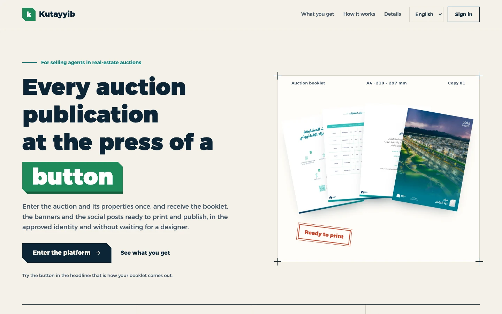
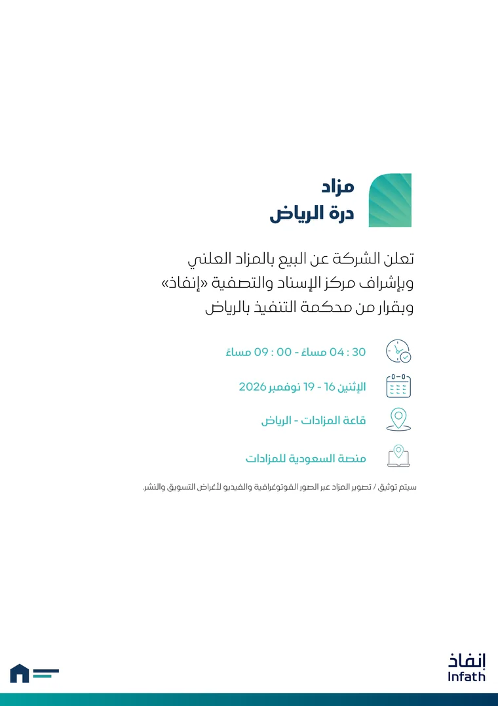
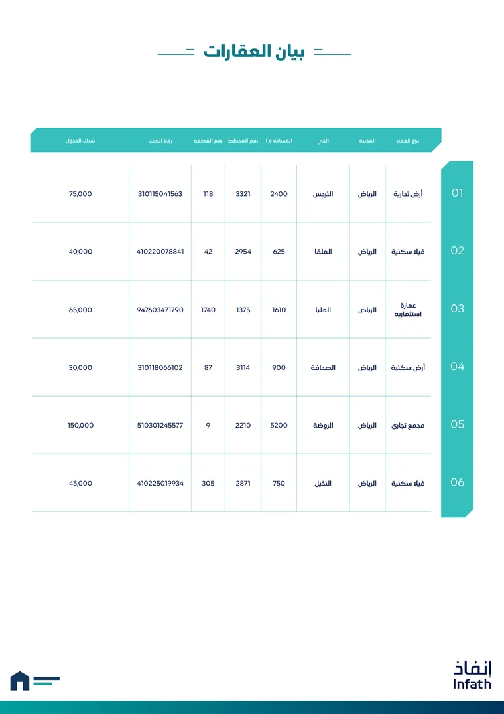
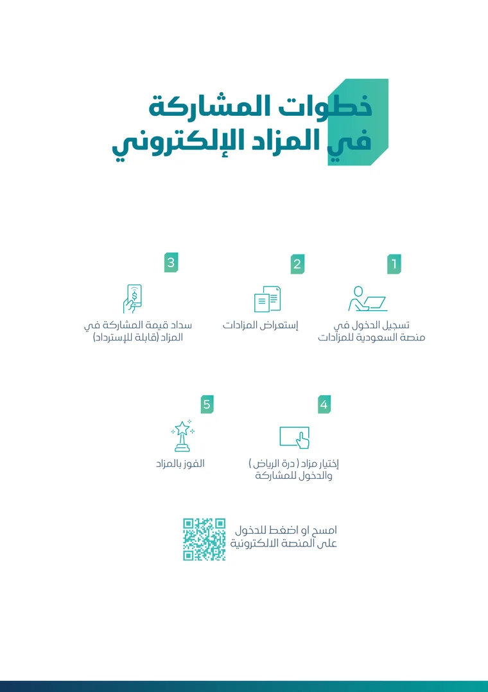
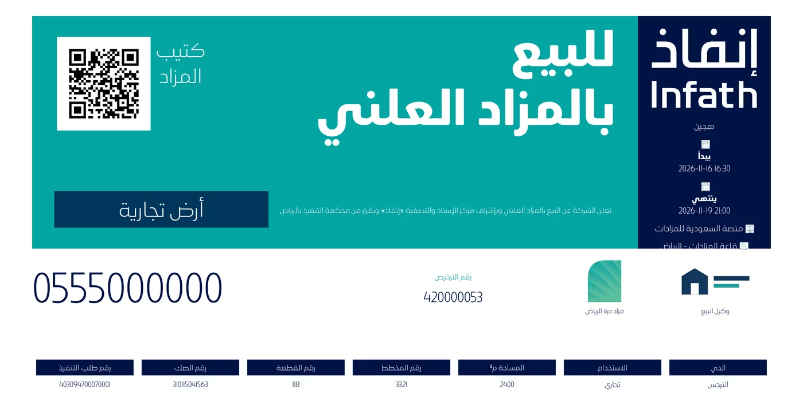
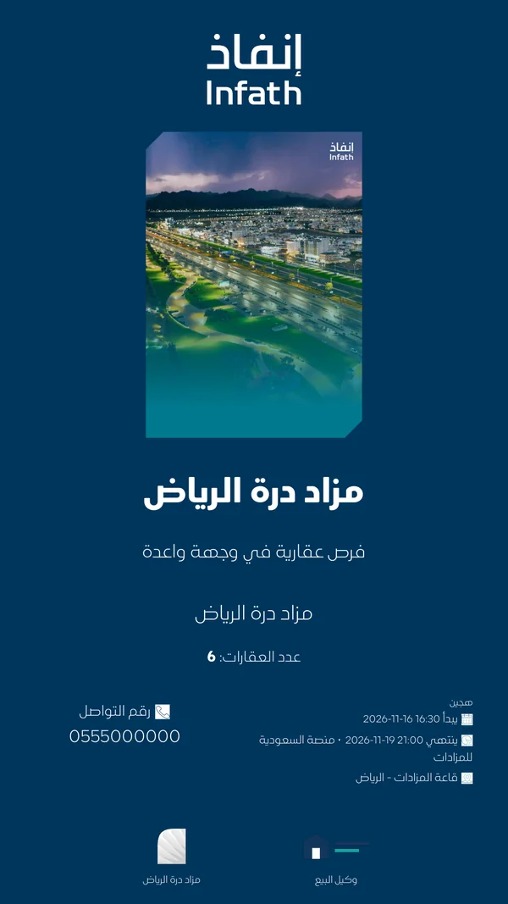
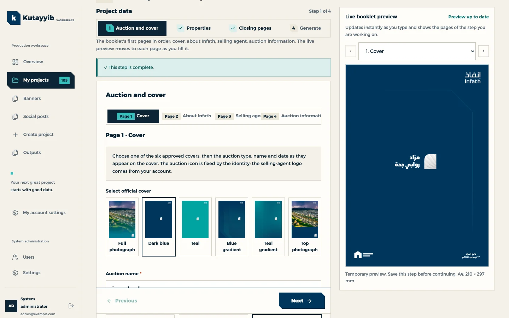
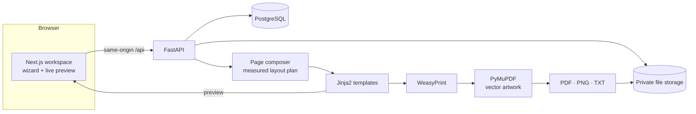

<div align="center">

# Kutayyib · كُتَيِّب

**Auction booklets, banners and social posts for real-estate selling agents — from one set of data, at the press of a button.**

[](https://github.com/mohammad-alajlouni/mazad/actions/workflows/deploy.yml)


[Live site](https://kutayyib.io) · [Getting started](#getting-started) · [Documentation](#documentation)



</div>

## Overview

Kutayyib is a web platform for selling agents who run real-estate auctions. An agent enters the auction and its properties once and receives three print-ready publications that follow the official marketing and visual identity guide for auctions:

- the **auction booklet** (A4 PDF, in a print edition with QR codes and a digital edition with links),
- a **banner** for each property, in six sizes from 2 × 2 m to 15 × 5 m,
- **social posts** for X, Instagram and stories, with caption text.

What is typed for the booklet is what appears on the banner and in the post, so no figure differs from one publication to the next. The interface and the generated documents are available in Arabic (right to left) and English.

## What it produces

Every picture below is a real output of the platform, generated from sample data.

<table>
  <tr>
    <td align="center" width="25%"><br><sub>Booklet cover</sub></td>
    <td align="center" width="25%"><br><sub>Auction details</sub></td>
    <td align="center" width="25%"><br><sub>Property summary</sub></td>
    <td align="center" width="25%"><br><sub>Participation steps</sub></td>
  </tr>
  <tr>
    <td align="center" colspan="2"><br><sub>Banner, 4 × 2 m</sub></td>
    <td align="center"><br><sub>Instagram post</sub></td>
    <td align="center"><br><sub>Story</sub></td>
  </tr>
</table>

## Highlights

- **One project, every publication.** Auction data, properties, photographs and the selling agent's profile are entered once and shared by the booklet, the banners and the posts.
- **A wizard in the order of the booklet's pages.** Four steps: auction and cover, properties, closing pages, generate.
- **Live preview.** The booklet page being filled renders beside the form and updates with every keystroke, including unsaved values and newly picked photographs.
- **Measured layout.** Text is measured with the booklet's own fonts before rendering: long values wrap or are set smaller inside their boxes, tables paginate (twenty properties to a summary page), and anything that still cannot fit is reported at data entry rather than at export.
- **Vector artwork.** Covers, icons and fixed pages are placed in the exported PDF as the original vector files, not as raster copies.
- **Photograph editor.** Every uploaded photograph or logo is positioned in a frame with the exact proportions of its place on the page; the stored file is that cut.
- **Excel import.** Properties can be added one by one or imported in bulk from an approved workbook template, with a preview and row-level validation.
- **Auction types.** Physical, electronic and hybrid auctions each have their own fields, required checks and booklet pages.
- **Review and approval.** Outputs start as drafts; final files are downloadable only after approval, and later data changes mark them as needing regeneration.
- **Bilingual.** Arabic and English interface with persistent RTL/LTR selection, and a public landing page in both languages.

## How it works



1. **Auction and cover** — choose one of six approved covers, then enter the auction's name, type and schedule.
2. **Properties** — add each property with its deeds, boundaries, features, rental contracts and photographs, or import them from Excel.
3. **Closing pages** — the contact number and the links printed as QR codes.
4. **Generate** — one button produces the booklet, the banners and the social posts together.

## Tech stack

| Layer | Technology |
|---|---|
| Frontend | Next.js 16 (App Router), React 19, TypeScript, next-intl |
| Backend | FastAPI, Pydantic, SQLAlchemy 2, Alembic |
| Database | PostgreSQL 16 (JSONB for auction and property data) |
| Document rendering | Jinja2 templates → WeasyPrint (HTML to PDF) → PyMuPDF (vector artwork, PNG export) |
| Text measurement | Pillow with Raqm shaping, using the documents' own fonts |
| Import and codes | pandas / openpyxl for Excel, `qrcode` and `python-barcode` |
| Tests | pytest (backend), Playwright (end-to-end browser tests) |
| Delivery | Docker Compose, Nginx, GitHub Actions |

## Architecture



Data is validated once (Pydantic) whether it is typed or imported. Generation works on a snapshot of the project, so a generated output always matches the data it was made from. The composer turns that snapshot into a page plan; the same templates render the live preview in the browser and the exported PDF.

```text
backend/
  app/api/            authenticated routes: projects, ingestion, outputs, profile, settings
  app/generation/     page composer, layout fitting, rendering engine, preflight checks
  app/services/       workflow rules, Excel import, banners, social posts, storage
  app/templates/      HTML/CSS templates, fonts and reference artwork
  migrations/         Alembic migrations
  scripts/            builders for the packaged vector artwork
  tests/              pytest suite
frontend/
  app/                layout, global styles, landing page styles
  components/         workspace, wizard, live preview, photograph editor, landing page
  messages/           Arabic and English interface text
  e2e/                Playwright browser tests
deploy/               Nginx configuration and deployment scripts
docs/                 design notes, workflows and operations guides
samples/              sample workbooks and images
```

## Getting started

### With Docker

Requires Docker with Compose v2.

```sh
cp .env.example .env      # then replace POSTGRES_PASSWORD, JWT_SECRET and ADMIN_PASSWORD
docker compose up --build -d
```

Open <http://localhost:8080> and sign in with the administrator credentials from `.env`. Interactive API documentation is at <http://localhost:8080/docs>. Migrations and the administrator bootstrap run when the backend starts; the database and generated files persist in named volumes.

### Local development

Requires Python 3.12+, Node 22+, PostgreSQL 14+ and the native Pango libraries used by WeasyPrint.

```sh
# macOS:          brew install pango
# Debian/Ubuntu:  apt-get install libpango-1.0-0 libpangoft2-1.0-0 libharfbuzz-subset0 fonts-noto-core

python3 -m venv backend/.venv
backend/.venv/bin/pip install -r backend/requirements-dev.txt
npm --prefix frontend ci
cp .env.example .env      # set the secrets and point DATABASE_URL at a local database
```

```sh
# Terminal 1 — API on http://127.0.0.1:8000
cd backend
.venv/bin/alembic upgrade head
.venv/bin/python -m app.bootstrap
.venv/bin/uvicorn app.main:app --host 127.0.0.1 --port 8000 --reload

# Terminal 2 — web app on http://localhost:3000
cd frontend
npm run dev
```

Next.js proxies `/api` to the backend. The browser uses same-origin HttpOnly session cookies. Accounts are created by an administrator; there is no public sign-up.

## Configuration

Settings are read from the root `.env` file; environment variables take precedence. See [`.env.example`](.env.example).

| Variable | Purpose |
|---|---|
| `DATABASE_URL` | SQLAlchemy PostgreSQL connection URL (Compose sets the internal host) |
| `POSTGRES_DB`, `POSTGRES_USER`, `POSTGRES_PASSWORD` | Database initialisation for Compose |
| `JWT_SECRET` | Session signing secret, 32+ random characters |
| `ADMIN_EMAIL`, `ADMIN_PASSWORD` | First administrator account; the password needs 12+ characters |
| `STORAGE_DIR` | Private directory for uploads and generated files |
| `CORS_ORIGINS` | Comma-separated trusted browser origins |
| `COOKIE_SECURE` | `true` behind HTTPS in production |
| `MAX_UPLOAD_MB` | Per-file upload limit (default 10) |
| `AI_API_KEY`, `AI_BASE_URL`, `AI_MODEL` | Optional OpenAI-compatible provider for narrative drafts; generation works without it |
| `API_INTERNAL_URL` | API address used by the Next.js rewrite (build time) |
| `WEB_CONCURRENCY` | API worker processes in the container (default 3; each needs about 200 MB) |

Never commit `.env`.

## Testing

```sh
# Backend: runs against a disposable SQLite database by default
cd backend
.venv/bin/python -m pytest -q

# Frontend: type check, production build and browser tests
cd frontend
npm run typecheck
npm run build
npx playwright install chromium
npm run test:e2e           # needs the API and the web app running
```

The backend suite (over 200 tests) covers validation, the page composer and measured layout, exported PDFs, migrations, access control and each output type. The Playwright suite drives the real application through the wizard, Excel import, the photograph editor, generation, approval and both languages. To run the backend suite on PostgreSQL, set `TEST_DATABASE_URL` to a disposable database whose name ends in `_test`.

## Deployment

Every push to `main` starts the **Deploy Kutayyib** workflow, which builds the new release on the server, backs up the database and files, activates the release and checks the live site; a failed activation restores the previous images. Details and operations are described in [automatic deployment](docs/automatic-deployment.md) and [deployment and operations](docs/deployment.md).

## Documentation

| Topic | Document |
|---|---|
| System design and data integrity | [docs/architecture.md](docs/architecture.md) |
| HTTP API | [docs/api.md](docs/api.md) |
| Booklet workflow and accounts | [docs/booklet-user-flow.md](docs/booklet-user-flow.md) |
| One project for all publications | [docs/shared-project-workflow.md](docs/shared-project-workflow.md) |
| Auction types and validation | [docs/auction-types-and-validation.md](docs/auction-types-and-validation.md) |
| Live booklet preview | [docs/live-booklet-preview.md](docs/live-booklet-preview.md) |
| Excel import template | [docs/approved-excel-template.md](docs/approved-excel-template.md) |
| Banners | [docs/banner-workspace.md](docs/banner-workspace.md) |
| Social posts | [docs/social-workspace.md](docs/social-workspace.md) |
| Selling agent profile | [docs/account-profile.md](docs/account-profile.md) |
| Deployment | [docs/deployment.md](docs/deployment.md), [docs/automatic-deployment.md](docs/automatic-deployment.md) |

Several of these documents are written in Arabic.

## Scope and limitations

- Generation runs synchronously on a single host; very large projects need capacity testing.
- The official fixed pages of the booklet (introduction, terms) exist in Arabic only and stay Arabic in English documents.
- The original of an edited photograph is not kept: changing the cut means uploading the photograph again.
- Besides the auction publications, the backend still carries a set of generic document generators (studies, forms, reports) built on development templates; they are not client-approved documents.

## Brand assets and license

© 2026 Mohammad Alajlouni. All rights reserved.

This is proprietary software, not open source. The code is published for reference only: no permission is granted to use, copy, modify or distribute it without prior written consent.

The Infath name, logos, fonts and reference artwork packaged under `backend/app/templates/infath/` belong to their respective owners. They are included so that generated documents follow the official identity guide, and their provenance is recorded in [`provenance.json`](backend/app/templates/infath/assets/provenance.json). The landing page's display typeface, Alexandria, is distributed under the SIL Open Font License.
